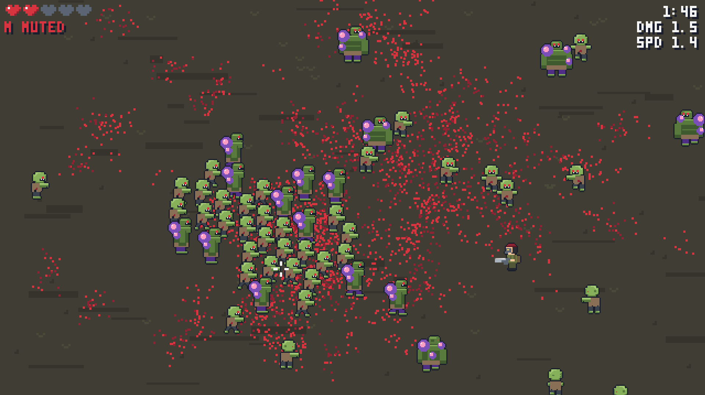
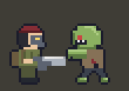
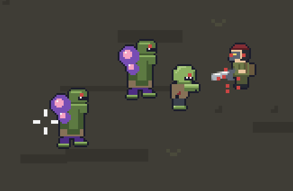

# Zombit

A top-down zombie holdout in pixel art. It runs in the browser from a single HTML file of about 12 KB, with no assets and no runtime libraries.



## Play

Open `dist/index.html` in a desktop browser. That one file is the whole game.

| Input | Action |
|---|---|
| `W` `A` `S` `D` | Move |
| Mouse | Aim |
| Hold left button | Fire |
| `Esc` | Pause and resume |
| `M`, or click the sound label | Mute |

## The game

Survive as long as you can. Your score is the time you stay alive, and your best time is saved in the browser. You have five lives.



### Enemies

| Enemy | Health | Damage | Notes |
|---|---:|---:|---|
| Walker | 3 | 1 | Walks straight at you |
| Tank | 14 | 2 | Slow, takes no knockback, appears from 0:20, drops a power-up |
| Boss | 90 | 2 | Floats, shoots orbs, takes no knockback, drops five power-ups |



### Boss fights

A boss arrives after every minute of play. During the fight the timer stops, no other zombies spawn, and a health bar shows at the top of the screen. The boss fires orbs at your current position, so keep moving.

Every defeated boss makes the rest of the round harder. All zombies get 50% more of their base health, and orbs fly faster and come more often.

### Power-ups

| Power-up | Effect |
|---|---|
| Sword | Damage +0.1 |
| Lightning | Attack speed +0.1 |
| Heart | One life back, stays on the ground while you have full life |

Your damage and attack speed are shown under the timer. They reset when a new round starts.

## Development

Requires Node 22.18 or newer. All commands run from `src/`.

```bash
cd src
npm install
npm run dev
```

| Command | What it does |
|---|---|
| `npm run dev` | Serves the game on http://localhost:8123 and rebuilds on save. Reload the page to see changes. |
| `npm run build` | Writes the packed game to `dist/index.html` and fails above 20,000 bytes |
| `npm run images` | Renders the art to `images/` |

### Project layout

```text
dist/index.html       the finished game
images/               rendered art and screenshots
src/
  game/               the game code
  art/art.px.js       all graphics, written as pixel data in code
  tools/              build and image scripts
```

| File in `src/game/` | Purpose |
|---|---|
| `main.js` | Game modes, high score, main loop |
| `sim.js` | Movement, collisions, weapon, drops, boss timing |
| `zombies.js` | Zombie types and their behaviors |
| `gfx.js` | Baking sprites and all drawing |
| `input.js` | Keyboard and mouse |
| `audio.js` | Synthesized sound |
| `grid.js` | Spatial grid for collisions |
| `state.js` | Game state in typed arrays |
| `config.js` | Constants and balance values |

### How it stays small

- All sprites are text in the code and are baked to an offscreen canvas at start, with outlines and mirrored views. Mirroring means 8 directions need only 5 drawn views.
- Sprite rows are stored once in a dictionary and compressed with run-length encoding.
- All sound is synthesized with Web Audio.
- The favicon is drawn at start from the zombie sprite.
- The build bundles with esbuild, minifies with Terser and packs with Roadroller. The game is about 24 KB minified and about 12 KB packed.

The game loop avoids allocations by using typed arrays, object pools and a spatial grid. It keeps a steady frame rate with 250 zombies on screen.

### Add a zombie type

1. Draw the figure in `src/art/art.px.js` as `name_S`, `name_SE`, `name_E`, `name_NE` and `name_N`, with three frames each.
2. Register it in `FIGURES` in `src/tools/build.mjs`.
3. Add a row to `ZOMBIES` in `src/game/zombies.js`:

```js
{ fig: 'tank', hp: 14, speed: 12, radius: 7, mass: 3, damage: 2, drops: 1, unlock: 20, weight: 1, noKnock: true, tint: null, scale: 1, act: chase },
```

Balance values are in `src/game/config.js`.
